<div align="center">



<br />

[](LICENSE)
[](https://go.dev/)
[](https://github.com/Fizm00/ClutterLess-Organizer/releases/latest)
[](https://github.com/Fizm00/ClutterLess-Organizer/actions)
[](https://github.com/Fizm00/ClutterLess-Organizer/releases)

<br />

**ClutterLess Organizer** (`cless`) is a deterministic local file organizer and background filesystem automator.<br />
Designed for high throughput, zero data loss, and seamless day-to-day desktop hygiene.

[Installation](#installation) • [Desktop GUI](#desktop-gui) • [Quick Start](#quick-start) • [File Categories](#file-categories--routing) • [CLI Reference](#cli-reference) • [Safety Guarantees](#safety-guarantees) • [Uninstall](#uninstallation)

<br />



</div>

---

## Overview

Modern developer workflows generate immense file debris: daily downloads, screenshots, code archives, data dumps, and invoices scatter across directories. Manual sorting is tedious and error-prone.

`cless` monitors incoming directories (such as `~/Downloads`) and evaluates user-defined rules to route files to organized directories with dynamic date and extension templating. It operates as either an on-demand batch utility or a headless daemon.

### Design Principles

- **Zero Data Loss Guarantee:** Never overwrites files. Name collisions automatically resolve to incremental suffixes (`file (1).ext`) unless explicitly instructed to skip.
- **Transactional & Reversible:** Every file relocation is recorded in an append-only JSON Lines transaction log. Any batch can be restored to its exact previous location with `cless undo`.
- **Atomic Operations:** Cross-volume transfers use copy, `fsync` validation, byte-size verification, atomic rename, and verified source cleanup.
- **Write-Stability Debounce:** Active downloads (`.crdownload`, `.part`, `.tmp`) and in-flight writes are monitored until their size and modification timestamps stabilize for `stable_after_seconds` before any move takes place.
- **Native OS Integration:** Resolves Windows Known Folders (with OneDrive redirection support), Linux XDG specifications, and macOS system conventions with zero external runtime dependencies.

---

## Installation

### Automated Installer (Recommended)

The automated script inspects system architecture (`amd64` or `arm64`), resolves the latest verified release tag from GitHub without API rate limits, verifies the archive, installs the executable to user programs, and configures the environment `PATH`.

#### Windows (PowerShell)

```powershell
irm https://raw.githubusercontent.com/Fizm00/ClutterLess-Organizer/main/install.ps1 | iex
```

_To install a specific version:_

```powershell
$env:CLESS_VERSION="1.0.0"; irm https://raw.githubusercontent.com/Fizm00/ClutterLess-Organizer/main/install.ps1 | iex
```

#### Linux & macOS (Bash / Zsh)

```bash
curl -fsSL https://raw.githubusercontent.com/Fizm00/ClutterLess-Organizer/main/install.sh | bash
```

_To install a specific version:_

```bash
CLESS_VERSION="1.0.0" curl -fsSL https://raw.githubusercontent.com/Fizm00/ClutterLess-Organizer/main/install.sh | bash
```

---

<details>
<summary><b>Manual Installation (Precompiled Binaries)</b></summary>
<br />

Download standalone archive binaries directly from [GitHub Releases](https://github.com/Fizm00/ClutterLess-Organizer/releases/latest):

| Platform    | Architecture             | Archive                                                                                              |
| ----------- | ------------------------ | ---------------------------------------------------------------------------------------------------- |
| **Windows** | x86_64 / amd64           | [`cless_1.0.0_windows_amd64.zip`](https://github.com/Fizm00/ClutterLess-Organizer/releases/latest)   |
| **Windows** | ARM64                    | [`cless_1.0.0_windows_arm64.zip`](https://github.com/Fizm00/ClutterLess-Organizer/releases/latest)   |
| **Linux**   | x86_64 / amd64           | [`cless_1.0.0_linux_amd64.tar.gz`](https://github.com/Fizm00/ClutterLess-Organizer/releases/latest)  |
| **Linux**   | ARM64                    | [`cless_1.0.0_linux_arm64.tar.gz`](https://github.com/Fizm00/ClutterLess-Organizer/releases/latest)  |
| **macOS**   | Apple Silicon (M-series) | [`cless_1.0.0_darwin_arm64.tar.gz`](https://github.com/Fizm00/ClutterLess-Organizer/releases/latest) |
| **macOS**   | Intel x86_64             | [`cless_1.0.0_darwin_amd64.tar.gz`](https://github.com/Fizm00/ClutterLess-Organizer/releases/latest) |

Extract the binary and place it in a folder included in system `PATH` (such as `%LOCALAPPDATA%\Programs\cless` or `/usr/local/bin`).

</details>

<details>
<summary><b>Build from Source (Go 1.22+)</b></summary>
<br />

```bash
go install github.com/Fizm00/organizer/cmd/organizer@latest
```

_(Installs as `organizer`. Symlink or copy to `cless` for the shorthand alias)._

</details>

---

## Desktop GUI (`cless-gui`)

ClutterLess Organizer includes a desktop GUI application (`cless-gui`) built with **Wails v3**, **React**, and an official neutral **shadcn/ui** interface powered by **Tailwind CSS v4**.

It runs on top of the same Go engine (`internal/app`) and shares the exact same `config.yaml` and append-only `history.jsonl` files as the CLI.

### GUI Installation & Packages

Precompiled installers and portable archives are available on [GitHub Releases](https://github.com/Fizm00/ClutterLess-Organizer/releases/latest):

| Package Type | Platform | Architecture | Details |
| --- | --- | --- | --- |
| **Windows Installer** | Windows 10/11 | x86_64 / amd64 | `cless-gui_1.0.0_windows_amd64_installer.exe`<br />Per-user install to `%LOCALAPPDATA%\Programs\ClutterLess`, Start Menu shortcut, WebView2 bootstrapper detection, and safe uninstaller. |
| **Windows Portable** | Windows 10/11 | x86_64 / amd64 | `cless-gui_1.0.0_windows_amd64.zip`<br />Standalone executable with zero installation needed. |
| **Linux Archive** | Linux (Ubuntu, Debian, Fedora, Arch) | x86_64 / amd64 | `cless-gui_1.0.0_linux_amd64.tar.gz`<br />Includes binary, desktop file, and application icon. (Requires WebKit2GTK). |
| **macOS Archive** | macOS 12+ | Apple Silicon & Intel | `cless-gui_1.0.0_darwin_arm64.tar.gz` / `cless-gui_1.0.0_darwin_amd64.tar.gz`<br />Standalone native executable for macOS. |

### Core Screens & Workflow

1. **Overview:**
   - Real-time watcher status pill with pulsing indicator (`Watching`, `Paused`, `Error`).
   - Monitored folder tags with direct folder opener actions.
   - Attention callout for delayed or locked files (`.crdownload`, `.tmp` write debounce).
   - Recent activity table with middle-truncated paths, copyable paths, and quick navigation.
   - Primary `Organize now` button triggering the interactive preview flow.
2. **Preview & Run Sheet:**
   - Slide-out sheet inspecting pending moves before any disk modification occurs.
   - Categorized file list: *Will move* (with destination patterns), *Skipped* (with explicit reason), and *Unmatched*.
   - Selective checkboxes (default all selected) with live primary button counter ("Move 5 files").
   - Real-time execution progress counter and immediate undo toast upon completion.
3. **Activity & Safe Undo:**
   - Transaction batches grouped chronologically by date (*Today*, *Yesterday*, specific dates).
   - Batch header showing unique batch ID, move count, execution timestamp, and status badges (`Applied`, `Undone`, `Partially undone`).
   - One-click `Undo batch` rollback with safety validation: never overwrites existing target files, renames occupied destinations safely, and reports any missing files.
   - Segmented filter (`All`, `Applied`, `Undone`) and instant search across file names and destinations.
4. **Rules Management & Visual Tester:**
   - Ordered rule list reflecting priority ("*First match wins*").
   - Drag-and-drop rule reordering with accessible keyboard controls (`Alt+Up` / `Alt+Down`).
   - Rule editor dialog with multi-condition matching (extensions, name globs, regex, size limits, age), dynamic template insertion chips (`{year}`, `{month}`, `{day}`, `{ext}`, `{name}`), and live syntax validation matching CLI error messages.
   - Interactive rule tester to test arbitrary filenames against active rule sets in real time.
5. **Watched Folders Management:**
   - Visual folder cards showing path, direct folder picker button, and recursive scanning switch.
   - Collision safeguards preventing overlapping watch hierarchies and infinite loops.
6. **System Integration & Desktop Tray:**
   - **System Tray:** Live monochrome status icons (active, paused, error) in the Windows notification area. Left-click brings window to focus; context menu provides status line, quick pause/resume, organize now, and quit.
   - **Close-to-Tray:** Window close button minimizes to the system tray while keeping the file watcher active. Full application shutdown is performed via Tray -> Quit or `Ctrl+Q`.
   - **Single Instance:** Subsequent launches focus the running instance automatically.
   - **Opt-in Autostart:** Seamless boot-time autostart with `--hidden` flag configured without administrative rights (`HKCU\Software\Microsoft\Windows\CurrentVersion\Run`).
   - **Desktop Notifications:** Debounced system notifications summarizing file organization events without spamming.
7. **Settings & Themes:**
   - Appearance mode toggle: Dark, Light, or System theme.
   - Behavior controls for write stability delay (`stable_after_seconds`) and conflict strategy (`Rename` vs `Skip`).
   - Direct configuration actions: Open config file, Open history log, Export config, or Reset to defaults with confirmation.

### Relationship Between GUI and CLI

The GUI (`cless-gui`) and CLI (`cless`) are peers built over the same shared core engine:

- **Shared State:** Both access `%APPDATA%\cless\config.yaml` and `%APPDATA%\cless\history.jsonl`. Edits made in the CLI are detected by the GUI via filesystem events and reloaded automatically.
- **Watcher Single-Owner Lock:** A process lock (`%APPDATA%\cless\watcher.lock`) ensures only one watcher daemon runs at any given time. If `cless watch` is running in a terminal, the GUI watcher transitions to locked status and displays a non-destructive guidance banner.
- **Identical Logic:** Matching algorithms, dry-run evaluations, conflict counters, cross-volume transfers, and transaction logs behave identically in both interfaces.

---

## Quick Start

### 1. Initialize Default Configuration

Generate a structured configuration file with preconfigured rule sets:

```bash
cless init
```

_Platform default locations:_

- **Windows:** `%APPDATA%\organizer\config.yaml`
- **Linux:** `~/.config/organizer/config.yaml`
- **macOS:** `~/Library/Application Support/organizer/config.yaml`

### 2. Validate Rules Against a File

Verify how rules evaluate without moving any file:

```bash
cless rules test invoice_april_2026.pdf
```

### 3. Dry-Run Preview

Simulate organizing watched folders with zero filesystem modifications:

```bash
cless run --dry-run
```

### 4. Execute Organization

Execute the planned relocations:

```bash
cless run
```

### 5. Revert When Needed

Roll back the previous batch back to original paths:

```bash
cless undo
```

### 6. Continuous Real-Time Watcher

Run as a background filesystem daemon:

```bash
cless watch
```

---

## File Categories & Routing

`cless` provides 11 preconfigured default categories to route clutter into dedicated, structured hierarchies:

| Rule Name      | Match Condition                                                                               | Destination Pattern                  |
| -------------- | --------------------------------------------------------------------------------------------- | ------------------------------------ |
| **Invoices**   | RegEx: `(?i)(invoice\|faktur\|receipt\|kwitansi\|struk\|bukti.transfer\|pembayaran\|tagihan)` | `~/Documents/Finance/{year}-{month}` |
| **Images**     | `jpg, jpeg, png, gif, webp, bmp, svg, ico, tiff, tif, heic`                                   | `~/Pictures/Sorted/{year}`           |
| **Videos**     | `mp4, mkv, mov, avi, wmv, flv, webm, m4v`                                                     | `~/Videos/Sorted/{year}`             |
| **Audio**      | `mp3, wav, flac, aac, ogg, m4a, wma, opus`                                                    | `~/Music/Sorted/{year}`              |
| **Documents**  | `pdf, docx, doc, xlsx, xls, pptx, ppt, txt, md, rtf, odt, ods, odp, csv, tsv`                 | `~/Documents/Inbox/{ext}`            |
| **Books**      | `epub, mobi, azw3, djvu, cbr, cbz`                                                            | `~/Documents/Books`                  |
| **Data**       | `json, xml, yaml, yml, toml, sql, sqlite, db`                                                 | `~/Documents/Data/{ext}`             |
| **Creative**   | `blend, fbx, obj, stl, gltf, glb, dae, 3ds, psd, ai, xd, fig`                                 | `~/Documents/Creative_Assets`        |
| **Installers** | `exe, msi, dmg, deb, pkg, rpm, appimage, apk, iso`                                            | `~/Downloads/_Installers`            |
| **Archives**   | `zip, rar, 7z, tar, gz, bz2, xz, tgz`                                                         | `~/Downloads/_Archives`              |
| **Old stuff**  | File modification age `older_than: 90d`                                                       | `~/Downloads/_Old`                   |

### Path Templating Variables

Destinations in `config.yaml` support dynamic placeholders:

- `{year}`: 4-digit modification year (`2026`)
- `{month}`: 2-digit modification month (`04`)
- `{day}`: 2-digit modification day (`28`)
- `{ext}`: Lowercase file extension without dot (`pdf`)
- `{name}`: Base filename without extension (`contract_draft`)

---

## CLI Reference

```
Usage:
  cless [command] [flags]
```

### Core Commands

| Command                      | Description                                     | Useful Flags                                                      |
| ---------------------------- | ----------------------------------------------- | ----------------------------------------------------------------- |
| `cless run`                  | Execute organization on watched folders         | `--dry-run`, `--dir <path>`, `-y, --yes`                          |
| `cless watch`                | Continuously monitor folders for incoming files | `--dry-run`, `--dir <path>`, `--log-file <path>`, `--initial-run` |
| `cless undo`                 | Revert previous move transactions               | `--batch <id>`, `--dry-run`                                       |
| `cless folder list`          | Display all configured watch folders            | None                                                              |
| `cless folder add <path>`    | Add folder to the permanent watch list          | `-r, --recursive`                                                 |
| `cless folder remove <path>` | Remove folder from the watch list               | None                                                              |

### Configuration & Utilities

| Command                   | Description                                        | Useful Flags                      |
| ------------------------- | -------------------------------------------------- | --------------------------------- |
| `cless init`              | Create default configuration file                  | `--force`, `--path <custom_path>` |
| `cless config edit`       | Open active `config.yaml` in `$EDITOR` or Notepad  | None                              |
| `cless config path`       | Print path to the active configuration file        | None                              |
| `cless config validate`   | Validate configuration syntax and rule definitions | None                              |
| `cless rules list`        | Display active rules in priority order             | None                              |
| `cless rules test <file>` | Test which rule matches a target filename          | None                              |
| `cless history`           | Display recent move transactions and batch IDs     | `--limit <n>`, `--batch <id>`     |
| `cless uninstall`         | Remove binary and clean environment `PATH`         | `--purge-config`, `-y, --yes`     |
| `cless version`           | Display version, commit, and build date            | None                              |

### Global Flags

- `--config <path>`: Override configuration file path.
- `--no-color`: Disable ANSI color escape sequences.
- `-v, --verbose`: Enable detailed debug logging.
- `-h, --help`: Display command usage and contextual examples.

---

## Safety Guarantees

1. **Collision Avoidance:** Existing target filenames are automatically suffixed with incremental numbers (`file (1).ext`) unless configured to skip. Existing data is never overwritten.
2. **Cross-Volume Transfer Integrity:** When source and target reside on different physical drives or partitions, `cless` writes to a temporary file, invokes `fsync` to flush disk buffers, checks exact byte counts, performs an atomic rename, and only then deletes the source file.
3. **Write Stability Debounce:** Files in the process of downloading or unpacking are deferred until file size and modification timestamps remain static for `stable_after_seconds`.
4. **Non-Destructive Simulation:** `--dry-run` performs full rule evaluation and destination calculation in-memory without making filesystem modifications.
5. **Deterministic Transaction Rollback:** Operations append structured JSON Lines records to `history.jsonl`. Restoring via `cless undo` returns files to their origins while checking target occupancy to prevent conflicts

---

## Autostart Daemon

To run `cless watch` automatically upon user login in the background without terminal windows:

- **Windows:** Task Scheduler (`schtasks`) or Startup folder VBScript launcher.
- **Linux:** Systemd user service (`systemctl --user enable cless.service`).
- **macOS:** Launchd user agent (`launchctl load ~/Library/LaunchAgents/com.cless.organizer.plist`).

Complete step-by-step setup guides are provided in [docs/AUTOSTART.md](docs/AUTOSTART.md).

---

## Uninstallation

To remove `cless` from the system:

### Option 1: Native Command

```bash
cless uninstall
```

_Optional parameters: `-y` (skip prompt), `--purge-config` (remove config files and history)._

### Option 2: Automated Script

- **Windows (PowerShell):**
  ```powershell
  irm https://raw.githubusercontent.com/Fizm00/ClutterLess-Organizer/main/uninstall.ps1 | iex
  ```
- **Linux & macOS:**
  ```bash
  curl -fsSL https://raw.githubusercontent.com/Fizm00/ClutterLess-Organizer/main/uninstall.sh | bash
  ```

---

## Contributing

Contributions and bug reports are welcome. Please consult [CONTRIBUTING.md](CONTRIBUTING.md) for local development setup, coding guidelines, and pull request procedures. Security disclosures should follow [SECURITY.md](SECURITY.md).

---

## License

ClutterLess Organizer is licensed under the **GNU Affero General Public License v3.0** (`AGPL-3.0-only`). See [LICENSE](LICENSE) for details.
Third-party licenses are documented in [THIRD_PARTY_LICENSES.md](THIRD_PARTY_LICENSES.md).
